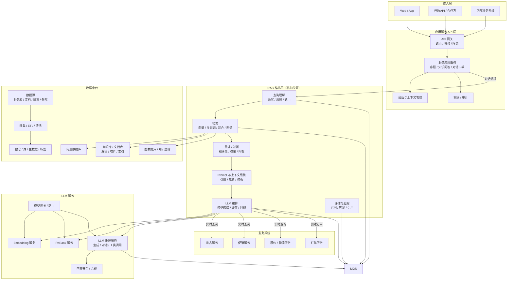
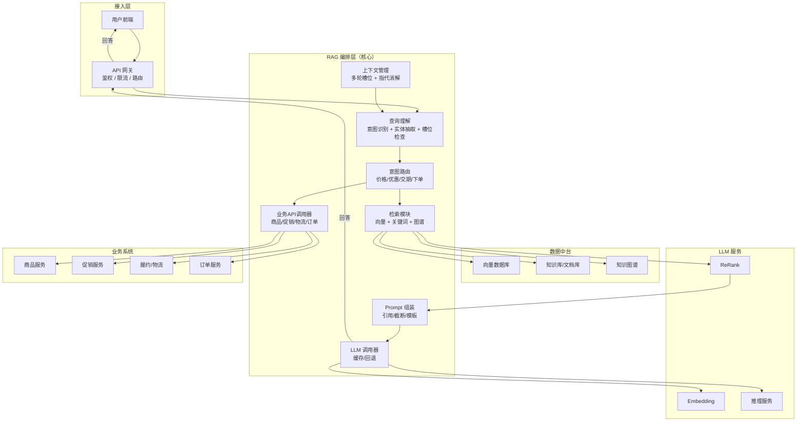
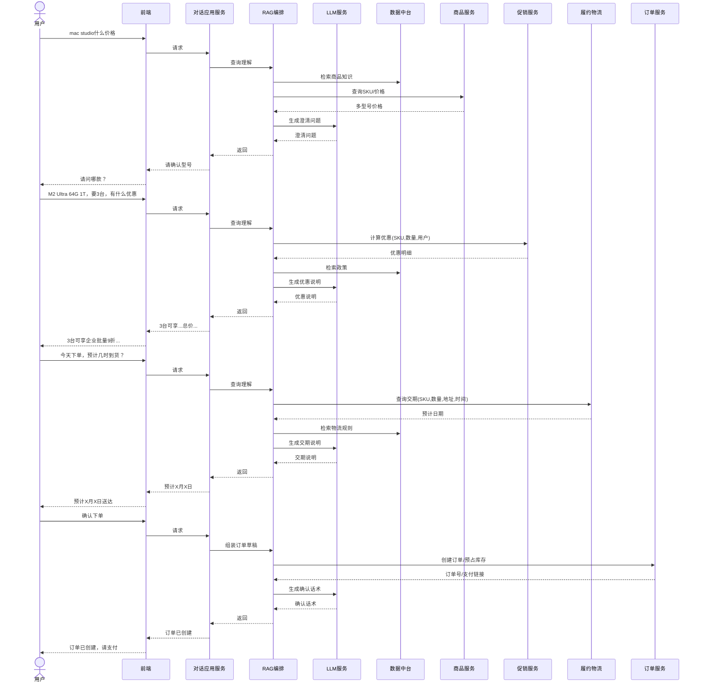
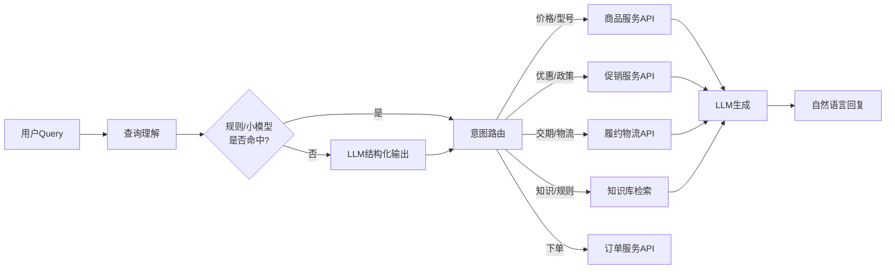

# 文档信息

| 字段 | 内容 |
|------|------|
| 文档名称 | 基于RAG的电商智能对话下单系统 — 产品需求与开发设计文档 |
| 版本号 | V1.0 |
| 创建日期 | 2026-10-11 |
| 文档状态 | 初稿 |
| 来源 | DeepSeek分享对话 [mxz9pwvtqk2409jyd0] |


# 一、产品需求文档（PRD）

## 1. 综述

### 1.1 项目背景与核心问题

在电商场景中，用户下单流程通常需要经历商品搜索、型号选择、优惠查询、配送确认、订单提交等多个步骤，操作路径长、信息分散。用户在购买决策过程中经常产生即时的咨询需求，例如“Mac Studio什么价格”“买3台有什么优惠”“今天下单什么时候能到”，而传统电商搜索和商品详情页无法以对话形式灵活响应这类多轮、多意图的咨询请求。

本项目旨在构建一套**基于RAG（检索增强生成）技术的对话引导式下单系统**，让用户通过自然语言对话完成从商品咨询、优惠查询、交期确认到订单创建的全流程。RAG在本系统中处于**应用服务API与LLM服务之间的智能编排层**位置：向上承接对话应用服务的业务请求，向下调用数据中台获取知识、调用LLM服务生成自然语言回答，同时调用各业务系统API获取实时数据。

### 1.2 核心业务流程 / 用户旅程地图

1. **阶段一：商品咨询与型号澄清** — 用户询问商品价格，系统识别型号歧义并要求澄清
2. **阶段二：优惠查询** — 用户确认型号和数量后，系统查询促销政策并计算优惠
3. **阶段三：交期查询** — 用户询问到货时间，系统查询库存和物流能力并返回预计日期
4. **阶段四：确认下单** — 用户确认后，系统组装订单草稿并调用订单服务创建订单

### 1.3 系统架构总览



> 图中RAG编排层位于架构中心，是连接应用服务API、数据中台、LLM服务和业务系统的关键枢纽。

### 1.4 关键数据流说明

RAG的核心数据流为：**用户提问 → 对话应用服务 → RAG查询理解（意图识别 + 实体抽取 + 槽位检查）→ 数据中台检索（知识/向量/图谱）+ 业务系统API调用（实时事实）→ LLM生成自然语言 → 用户澄清/确认 → 订单服务创建订单**。

关键设计原则：

- **LLM负责“会说话”** ：自然语言理解与生成
- **RAG负责“会查会调”** ：检索编排、业务API调用、上下文组装
- **业务系统负责“说真话”** ：价格、库存、优惠、交期以API返回为准
- **数据中台负责“提供知识与规则”** ：政策文档、规则库、知识图谱


## 2. 用户故事详述

### 阶段一：商品咨询与型号澄清

#### US-001: 商品价格查询与型号澄清

- **价值陈述**：作为消费者，我希望通过自然语言询问商品价格，当型号不明确时系统能主动澄清，以便准确获取目标商品的报价。

- **业务规则与逻辑**：
    - **前置条件**：用户已登录；商品知识库已索引商品基础信息
    - **操作流程（Happy Path）** ：用户输入“Mac Studio什么价格” → RAG查询理解识别意图为价格查询 → 检索商品知识库和商品服务API → 发现多个SKU匹配 → RAG识别型号歧义 → 调用LLM生成澄清问题 → 返回用户“请问您要哪款？M2 Max还是M2 Ultra？”
    - **异常处理**：商品不存在 → 返回友好提示；商品服务不可用 → 降级返回知识库中的参考价格并标注可能过期
    - **验收标准**：
        - 场景1：GIVEN 用户询问存在多个SKU的商品 WHEN 提交查询 THEN 系统返回澄清问题，列出可选型号
        - 场景2：GIVEN 用户询问单一SKU商品 WHEN 提交查询 THEN 系统直接返回准确价格

### 阶段二：优惠查询

#### US-002: 批量优惠计算与政策解释

- **价值陈述**：作为消费者，我希望在确认商品型号和数量后了解可享受的优惠，以便做出购买决策。

- **业务规则与逻辑**：
    - **前置条件**：用户已确认商品型号和数量；促销服务可用
    - **操作流程（Happy Path）** ：用户输入“要3台，可以享受什么优惠” → RAG调用促销服务API计算优惠（输入SKU、数量、用户身份） → 促销服务返回优惠明细 → RAG检索政策知识库补充规则说明 → LLM生成优惠解释 → 返回用户“3台可享企业批量9折，叠加满减¥500，总价¥80,497.3。教育优惠与批量折扣不可叠加”
    - **异常处理**：优惠冲突 → RAG检索政策并解释冲突原因；用户身份不满足 → 提示认证要求
    - **验收标准**：
        - 场景1：GIVEN 用户满足批量折扣条件 WHEN 查询优惠 THEN 返回正确优惠金额和政策说明
        - 场景2：GIVEN 用户同时满足两种互斥优惠 WHEN 查询优惠 THEN 系统提示冲突并给出最优方案

### 阶段三：交期查询

#### US-003: 预计交货日期查询

- **价值陈述**：作为消费者，我希望在决定下单前了解预计到货时间，以便合理安排收货。

- **业务规则与逻辑**：
    - **前置条件**：用户已确认SKU和数量；地址信息已知或可获取
    - **操作流程（Happy Path）** ：用户输入“今天下单，预计几时到货” → RAG获取用户默认地址 → 调用履约/物流服务API（输入SKU、数量、地址、期望下单时间） → 履约服务查询库存和配送时效 → 返回预计送达日期 → RAG检索物流规则库补充说明 → LLM生成交期说明
    - **异常处理**：地址缺失 → RAG主动澄清；地址不可达 → 提示更换地址；库存不足 → 推荐替代型号或到货通知
    - **验收标准**：
        - 场景1：GIVEN 用户有默认地址且库存充足 WHEN 查询交期 THEN 返回预计送达日期
        - 场景2：GIVEN 用户无默认地址 WHEN 查询交期 THEN 系统主动询问地址

### 阶段四：确认下单

#### US-004: 对话引导式订单创建

- **价值陈述**：作为消费者，我希望在确认所有信息后通过对话直接完成下单，无需切换到传统下单页面。

- **业务规则与逻辑**：
    - **前置条件**：所有必要槽位已填充（SKU、数量、地址、优惠已确认）；用户身份已认证
    - **操作流程（Happy Path）** ：用户输入“好，下单” → RAG汇总多轮槽位 → 生成订单草稿展示给用户确认 → 用户确认 → RAG调用订单服务API（创建订单、预占库存、锁定优惠） → 订单服务返回订单号和支付链接 → LLM生成确认话术 → 前端展示支付页
    - **异常处理**：库存预占失败 → 推荐替代或告知补货时间；优惠锁定失败 → 重新计算并展示；支付超时 → 订单取消、库存释放、优惠券退回
    - **验收标准**：
        - 场景1：GIVEN 所有槽位已填充 WHEN 用户确认下单 THEN 成功创建订单并返回支付链接
        - 场景2：GIVEN 库存不足 WHEN 用户确认下单 THEN 返回替代建议或补货通知


## 3. 功能需求清单

| 需求编号 | 功能模块 | 需求描述 | 优先级 |
|---------|---------|---------|--------|
| FR-001 | 查询理解 | 意图识别（价格/优惠/交期/下单）、实体抽取（商品/型号/数量/地址/时间）、槽位检查 | Must |
| FR-002 | 上下文管理 | 多轮对话上下文继承、指代词解析、省略句补全 | Must |
| FR-003 | 商品检索 | 从商品知识库和商品服务API检索SKU和价格信息 | Must |
| FR-004 | 型号澄清 | 当实体歧义时主动生成澄清问题 | Must |
| FR-005 | 优惠计算 | 调用促销服务API计算实时优惠，检索政策知识库补充解释 | Must |
| FR-006 | 交期查询 | 调用履约/物流服务API查询预计送达时间 | Must |
| FR-007 | 订单草稿 | 汇总多轮槽位信息，生成结构化订单草稿供用户确认 | Must |
| FR-008 | 订单创建 | 调用订单服务API完成下单、库存预占、优惠锁定 | Must |
| FR-009 | 权限校验 | 用户身份验证、企业认证校验、地址权限校验 | Must |
| FR-010 | 防幻觉机制 | 价格/优惠/交期以API返回为准，LLM输出必须带引用或结构化数据来源 | Must |
| FR-011 | 幂等处理 | 订单创建使用幂等键防止重复下单 | Must |
| FR-012 | 监控审计 | 全链路trace，记录RAG检索片段、LLM输入输出、订单状态变更 | Should |
| FR-013 | 反馈闭环 | 用户反馈和客服结果回流数据中台，用于评估和优化 | Should |


## 4. 非功能需求

| 类别 | 需求描述 |
|------|---------|
| **性能** | 单轮对话响应时间 ≤ 3秒（含LLM生成）；业务API调用超时 ≤ 2秒 |
| **可用性** | 系统可用性 ≥ 99.9%；LLM服务不可用时降级为规则模板回复 |
| **安全** | 用户身份鉴权；企业优惠需企业认证；敏感操作需二次确认；数据隔离按租户/用户 |
| **可观测性** | 全链路trace；检索召回率/准确率监控；LLM输出质量评估 |
| **一致性** | 订单库强一致；数据中台最终一致（CDC+事件流异步同步） |
| **扩展性** | RAG编排层可水平扩展；支持多模型路由和A/B测试 |


# 二、开发设计文档

## 1. 设计概述

### 1.1 任务和目标

本文档描述基于RAG的电商智能对话下单系统的技术架构和详细设计。系统核心目标是：通过对话交互完成商品咨询、优惠查询、交期确认和订单创建，由RAG编排层协调数据中台、LLM服务和业务系统API完成多轮对话流程。

### 1.2 设计原则

- **关注点分离**：LLM仅负责自然语言表达，事实数据由业务API提供，知识与规则由数据中台提供
- **防幻觉**：价格、优惠、交期以API返回为准；LLM输出必须带引用或结构化数据来源
- **分层降级**：查询理解优先使用规则/小模型，LLM作为复杂场景的兜底方案
- **幂等与一致性**：创建订单使用幂等键；库存预占、优惠锁定、订单写入保证一致性


## 2. 系统架构设计

### 2.1 分层架构

系统分为六个层次：

| 层次 | 职责 | 关键技术组件 |
|------|------|------------|
| **接入层** | 用户请求入口 | Web/App前端、API网关 |
| **应用服务API层** | 业务逻辑编排、鉴权、会话管理 | 对话应用服务、会话管理、权限审计 |
| **RAG编排层** | 查询理解、检索编排、业务API调用、Prompt组装 | 查询理解模块、检索引擎、编排引擎 |
| **数据中台** | 知识供给、向量检索、图谱查询 | 向量数据库、文档库、知识图谱、数仓 |
| **LLM服务** | 模型能力供给 | Embedding、ReRank、推理服务、安全过滤 |
| **业务系统** | 实时事实数据 | 商品服务、促销服务、履约物流、订单服务 |

RAG编排层处于架构中心位置，是连接应用服务API与LLM服务之间的**智能编排层**。向上被应用API调用，向下调用数据中台检索知识、调用LLM服务生成，同时调用业务系统API获取实时事实数据。

### 2.2 组件关系



### 2.3 关键数据流

**主链路（订单创建）** ：用户 → API网关 → 对话应用服务 → RAG编排 → 业务API调用（订单服务）→ 订单库 → 消息队列 → 数据中台（CDC异步回流）

**RAG增强链路**：用户提问 → 对话应用服务 → RAG查询理解 → 数据中台检索 + 业务API调用 → LLM生成 → 用户澄清/确认 → 订单服务创建订单

其中，订单创建主链路不直接依赖LLM/RAG，交易要求强一致、低延迟；RAG/LLM主要出现在下单前的智能导购、下单后的智能客服、运营分析、异常解释等场景。


## 3. 模块详细设计

### 3.1 查询理解模块

**职责**：接收用户输入，完成意图识别、实体抽取、槽位检查和上下文依赖判断。

**核心信号提取**：

| 信号 | 说明 | 示例 |
|------|------|------|
| 指代词 | 它、这个、那个、该 | "它多少钱？" |
| 省略 | 缺少主语/宾语 | "要3台" |
| 多意图 | 一句话含多个意图 | "多少钱，什么时候到？" |
| 实体歧义 | 一个词对应多个对象 | "Mac Studio"对应多个SKU |
| 槽位缺失 | 关键信息不全 | 问交期但没地址 |
| 领域外 | 不属于业务范围 | "今天天气怎么样？" |
| 置信度 | 分类模型给出的分数 | 0.92 / 0.41 |
| 输入长度 | 极短或极长 | "嗯""就那个" |

**上下文依赖判断**：

依赖上下文的典型信号包括指代词、省略句、追问（"那优惠呢？"）、确认/否定（"好""不要"）和序数指代（"第一个"）。不依赖上下文的信号包括完整主谓宾和明确实体。

**查询理解实现方式**：

| 方式 | 是否调用LLM | 适用场景 | 特点 |
|------|------------|---------|------|
| 规则/关键词/正则 | 否 | 固定表达（"价格""优惠""到货"） | 快、便宜、可控，泛化差 |
| 传统NLU小模型 | 否 | 意图分类、NER、槽位提取 | 延迟低、成本低，需训练数据 |
| Embedding语义路由 | 可调用Embedding模型 | 意图相似度匹配 | 泛化较好，难处理复杂槽位 |
| LLM结构化输出 | 是 | 复杂多轮、多槽位 | 准确率高，延迟和成本增加 |

**分层策略**：规则/小模型优先处理简单查询；复杂或多轮查询调用LLM做结构化输出（JSON格式），解析后路由到对应业务API。输出格式示例：

```json
{
  "intent": "price_query",
  "entities": {
    "product": "Mac Studio",
    "sku": null,
    "quantity": null
  },
  "missing_slots": ["sku"],
  "route": "product_service"
}
```

### 3.2 检索模块

**职责**：从数据中台获取相关知识片段和业务数据。

**检索策略**：

| 检索类型 | 数据源 | 适用场景 |
|---------|--------|---------|
| 向量检索 | 向量数据库 | 语义相似查询、FAQ匹配 |
| 关键词检索 | 文档库/知识库 | 精确规则查询、政策检索 |
| 混合检索 | 向量+关键词 | 综合场景，平衡语义和精确匹配 |
| 图谱检索 | 知识图谱 | 关系查询（商品-订单-用户关系） |

检索结果经过ReRank服务重排，结合相关性、权限和时效性进行过滤。

### 3.3 业务API调用器

**职责**：根据意图路由结果调用对应业务系统API获取实时事实数据。

| 意图 | 调用服务 | 输入参数 | 输出 |
|------|---------|---------|------|
| 价格查询 | 商品服务 | 商品名称/品类 | SKU列表、各SKU价格 |
| 优惠查询 | 促销服务 | SKU、数量、用户身份 | 优惠明细、总价 |
| 交期查询 | 履约/物流服务 | SKU、数量、地址、时间 | 预计送达日期、加急选项 |
| 下单 | 订单服务 | 订单草稿（SKU/数量/地址/优惠） | 订单号、支付链接 |

**关键设计**：所有实时事实数据（价格、库存、优惠、交期）必须以API返回为准，LLM仅负责将结构化数据转化为自然语言表达。

### 3.4 上下文管理模块

**职责**：维护多轮对话的槽位状态，处理指代消解和上下文继承。

**槽位定义**：

| 槽位 | 类型 | 必填 | 来源 |
|------|------|------|------|
| product | string | 是 | 用户输入 |
| sku | string | 是 | 用户确认/澄清 |
| quantity | integer | 是 | 用户输入 |
| address | object | 是 | 用户服务/用户输入 |
| coupon | string | 否 | 用户输入/自动匹配 |
| delivery_time | string | 否 | 用户输入 |

**多轮槽位填充**：当必要槽位不齐时，RAG主动生成澄清问题。例如SKU不明确时询问型号，地址缺失时询问收货地址。

### 3.5 LLM编排模块

**职责**：管理LLM调用，包括模型选择、缓存和回退策略。

**调用场景**：

| 场景 | 调用服务 | 说明 |
|------|---------|------|
| 澄清问题生成 | LLM推理 | 将结构化歧义信息转为自然语言问题 |
| 优惠解释生成 | LLM推理 | 将优惠明细转为可读说明 |
| 交期说明生成 | LLM推理 | 将预计日期+规则转为自然语言 |
| 订单确认话术 | LLM推理 | 生成订单确认和支付引导文案 |
| 复杂查询理解 | LLM推理 | 结构化输出意图和实体（可选） |

**缓存策略**：相似查询的LLM输出可缓存，减少延迟和成本。缓存key基于查询意图和实体组合生成。


## 4. 关键设计要点

### 4.1 防幻觉机制

- 价格、优惠、交期以业务API返回为准，LLM不编造事实
- LLM输出必须带引用或结构化数据来源
- 对LLM输出进行后验证：检查关键数字（价格、数量）是否与API返回一致

### 4.2 权限与安全

- 查询地址、优惠、订单必须校验用户身份
- 企业优惠需企业认证
- 敏感操作（如下单）需二次确认
- RAG检索时需带用户/租户权限过滤，避免越权

### 4.3 幂等与一致性

- 创建订单使用幂等键（Idempotency-Key）
- 库存预占、优惠锁定、订单写入需保证一致性
- 数据中台通过CDC/事件流异步消费订单数据，保证最终一致
- 支付超时：订单取消 → 库存释放 → 优惠券退回

### 4.4 异常处理

| 异常场景 | 处理策略 |
|---------|---------|
| 库存不足 | 推荐替代型号或提供到货通知 |
| 地址不可达 | 要求用户更换地址 |
| 优惠冲突 | RAG检索政策并解释冲突原因 |
| 支付超时 | 订单取消、库存释放、优惠券退回 |
| 商品服务不可用 | 降级返回知识库中的参考价格，标注可能过期 |
| LLM服务不可用 | 降级为规则模板回复 |


## 5. 接口设计

### 5.1 对话接口

```
POST /api/v1/chat
Content-Type: application/json
Authorization: Bearer <token>

{
  "session_id": "uuid",
  "message": "Mac Studio什么价格",
  "context": {}
}

Response:
{
  "session_id": "uuid",
  "reply": "请问您要哪款？M2 Max还是M2 Ultra？",
  "type": "clarification",
  "slots": {
    "product": "Mac Studio",
    "sku": null,
    "quantity": null
  },
  "trace_id": "uuid"
}
```

### 5.2 订单创建接口

```
POST /api/v1/orders
Content-Type: application/json
Authorization: Bearer <token>
Idempotency-Key: <key>

{
  "session_id": "uuid",
  "sku": "M2-ULTRA-64G-1T",
  "quantity": 3,
  "address_id": "addr_001",
  "coupon_id": "promo_batch_9",
  "confirmed": true
}

Response:
{
  "order_id": "ORD20261011001",
  "status": "pending_payment",
  "total_amount": 80497.30,
  "payment_url": "https://pay.example.com/...",
  "expires_at": "2026-10-11T12:30:00Z"
}
```


## 6. 监控与可观测性

| 监控维度 | 指标 | 说明 |
|---------|------|------|
| 对话质量 | 意图识别准确率 | 按意图类型分维度统计 |
| 检索质量 | 召回率、准确率 | 检索结果与期望结果对比 |
| LLM质量 | 答案准确率、幻觉率 | 人工评估+自动校验 |
| 性能 | P50/P95/P99延迟 | 各模块单独统计 |
| 业务 | 对话转化率、下单成功率 | 从对话到订单的转化漏斗 |
| 系统 | 可用性、错误率 | 各服务单独统计 |

全链路trace记录RAG检索片段、LLM输入输出、订单状态变更，用于问题排查和质量优化。


## 7. 附录

### 7.1 完整数据流时序图（对话引导式下单）



### 7.2 RAG内部路由示意图



### 7.3 修订历史

| 版本 | 日期 | 修订内容 | 作者 |
|------|------|---------|------|
| V1.0 | 2026-10-11 | 初稿，基于DeepSeek分享对话内容整理 | — |